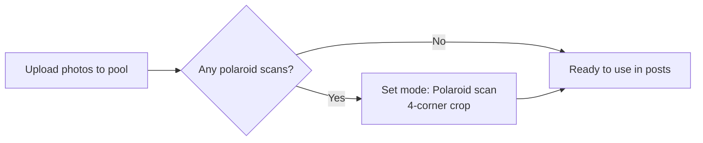
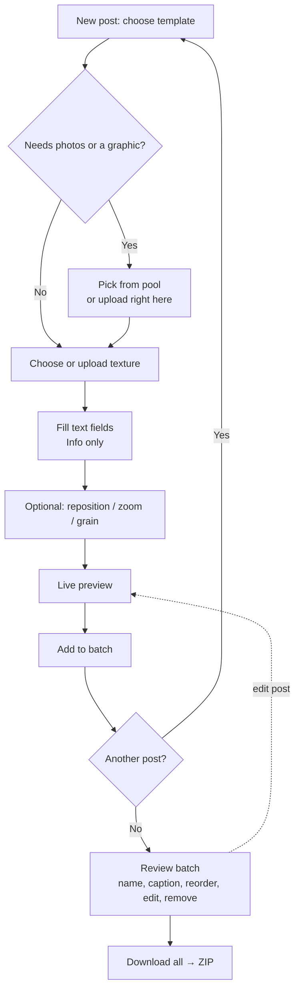

# Product Requirements: Chapter Social Generator

## Overview

Chapter Social Generator is a single-purpose, browser-based tool for making Instagram grid posts for [Chapter](https://www.chapter.nyc), a NYC social club that runs monthly themed events. The user picks one of a fixed set of brand templates, fills it with photos and text, previews it, and exports finished PNGs that are ready to upload to Instagram.

**Problem it solves:** the templates were designed in Illustrator and then recreated in Adobe Express for day-to-day use. Express hasn't produced quality, consistent output: style elements such as the drop shadow, texture treatment, polaroid frame and type drift from post to post. The generator makes creating content easier and locks those style elements down in code, so every post matches the design.

**Primary user:** Chapter's founder, producing a handful of posts after each event and before upcoming ones.

**Shape of the product:** a static site with input in and PNGs out. There are no accounts, no backend, no CMS, and nothing persists between sessions.

## Goals and non-goals

### Goals

- Produce pixel-accurate, on-brand Instagram grid posts from five templates.
- Make a session's worth of posts (typically 3–15) quickly: upload photos once, build several posts, download them all at once.
- Handle both regular phone photos and photos of real polaroids.
- Export at Instagram's 3:4 portrait size: **1080×1440 PNG**.

### Non-goals (v1)

- Instagram Stories (9:16) and Reels covers.
- Carousel management. The tool outputs individual PNGs, and he assembles carousels in Instagram.
- Posting or scheduling to Instagram.
- Accounts, saved drafts, or any persistence, including browser storage (`localStorage`, IndexedDB). Closing the tab ends the session.
- Mobile-optimized layout. The tool is designed for a laptop.
- Persisting uploaded textures. Uploaded textures are usable only during the session.
- Auto-incrementing the event number.
- Automatic polaroid edge detection.
- Editing templates in the UI. Templates are defined in code (see [Template Spec](template-spec.md)).

## Brand context

Source: *Wordmark and Social Template Brief* (designer's brief to the founder) and the template files `CoverPost.ai`, `GraphicPost.ai` and `InfoPost.ai`.

- **Pillars:** nostalgic, hip, fun, approachable.
- **Concept, "About Last Night…":** 2010s party photography, Brooklyn and indie-sleaze energy, polaroids.
- **Visual system:** content sits on a photographed **floor, wall, or table texture** (wood parquet, terrazzo, white tile, etc.) with a **mild drop shadow** for depth. Photos are candid and casual.
- **Type in templates:**
  - **Druk** (condensed, bold) for the wordmark and headlines. Chapter holds the license. It's also used for titles in the generator UI (see [Generator UI notes](#generator-ui-notes)).
  - **Instrument Serif** for body copy.
- **Marks:**
  - The custom `chapter` wordmark (modified Druk).
  - The `ch.` secondary mark.
  - Events are numbered like chapters: `ch. 1`, `ch. 2`, and so on.

## Templates

All templates output **1080×1440 PNG** (3:4). Exact layout, sizes, colors and field limits are defined in the [Template Spec](template-spec.md).

| ID | Template | Purpose | Inputs | Reference |
|---|---|---|---|---|
| `cover` | **Cover** | Hero post with the brand front and center | 1 photo (in a polaroid), background texture. The `chapter` wordmark overlays the photo. | `CoverPost.ai`, `First Post@2x.png` |
| `photo` | **Photo** | Post-event photo | 1 photo (in a polaroid), background texture | `polaroidArtboard 3@2x.png` |
| `multi-photo` | **Multi-Photo** | Several post-event photos in one image | 2+ photos (in polaroids), background texture | *TBD: needs a design* |
| `graphic` | **Graphic** | Upcoming event with an event graphic | 1 graphic image, background texture | `GraphicPost.ai`, `graphic.png` |
| `info` | **Info** | Upcoming event details. Usually slide 2 after Graphic. | Event number, title, body, date/time, location, background texture | `InfoPost.ai`, `text_preferred.png` |

## Features and requirements

### Session photo pool

| Requirement | Acceptance criteria |
|---|---|
| Upload many photos at once via a file picker or drag-and-drop. | Selecting 20 photos adds all 20 to the pool as thumbnails within a few seconds. JPEG, PNG, WebP and HEIC are accepted. |
| Photos stay in the pool for the whole session. | After a post is added to the batch, all pool photos are still available for the next post. |
| Indicate which photos have been used. | A photo used in any batch post shows a "used" marker and a count. It stays selectable. |
| Remove a photo from the pool. | A photo that a batch post uses can't be removed until those posts are removed (the button is disabled and says why). Removing a photo that is in the post being edited asks for confirmation first, then empties that slot. |
| Upload from inside a post. | When a template needs a photo or graphic, the slot picker also offers an upload, which adds the file to the pool and fills the slot. He never has to leave the post to add a photo. Photos are chosen by clicking them in the Photos panel (there is no second list of photos inside the post): the click fills the selected position, then the next empty position is selected, so clicking photos one after another fills the post. In the panel, the photo in the selected position has a halo, other photos in the post have a dark border and their position number, and a photo used by a batch post is tagged "Used in batch". |

### Photo input modes

| Requirement | Acceptance criteria |
|---|---|
| Each photo has a mode: **Regular photo** (default) or **Polaroid scan**. | The mode can be toggled per photo, in the pool or in the slot editor. |
| **Regular photo:** the template draws the polaroid frame. | The photo fills the polaroid's image window, and the generated frame matches the reference designs. |
| **Polaroid scan:** the user crops out the real polaroid with a four-corner crop. | Dragging four corner handles defines a quadrilateral, which is perspective-corrected into a rectangle. The result replaces the whole polaroid in the template, and no generated frame is drawn. |

### Template selection and editing

| Requirement | Acceptance criteria |
|---|---|
| Choose a template. | The editor opens on the template picker. All five templates are selectable, each with a thumbnail. Switching template mid-post keeps compatible inputs: the texture, and photos between Cover, Photo and Multi-Photo. Info text and a graphic don't carry over, and switching away from typed text asks for confirmation. |
| Choose photos for photo slots. | Each photo slot is filled by choosing from the pool. Multi-Photo lets him choose how many photos (range TBD in the Template Spec). |
| Swap photos between slots. | In a post with more than one photo, the slot editor shows one numbered thumbnail per position. Clicking one selects that position, to fill from the Photos panel or adjust. Dragging one onto another swaps the two photos, and each keeps its own pan and zoom. Dragging onto an empty position moves the photo there. The selected position is outlined in the preview (never in the export), and clicking a polaroid in the preview selects it. |
| Auto-fit photos. | By default each photo is center-cropped to fill its slot. |
| Optionally reposition and zoom a photo. | He drags the photo in the preview to pan, and zooms with a slider in the controls or by scrolling over the photo. The photo can never be panned to leave an empty gap in the slot. There is a "Reset" button. |
| Optional film look. | A per-post "Film look" toggle, off by default, that adds grain, a soft glow and a slight fade to every photo in the post (not the frame, texture or text). The values are fixed in code. |
| Fill text fields (Info template). | Fields: event number (numeric, rendered as `ch. N`), title, body, date/time, location. The preview updates as he types. Overflow behavior is defined in the Template Spec. |
| Choose a background texture. | Pick from the bundled texture library, shown as thumbnails. |
| Upload a one-off texture. | An uploaded image is added to the texture picker for this session only. It is never saved. |

### Preview and render

| Requirement | Acceptance criteria |
|---|---|
| Live preview. | The preview updates within about 100 ms of any input change and matches the exported PNG exactly. |
| Brand-accurate render. | Output matches the reference PNGs in layout, type (Druk, Instrument Serif), colors and drop shadows when given the same inputs. |
| Fonts are never silently wrong. | Instrument Serif is bundled, and rendering waits for it. Druk is licensed and is not bundled: it is used when installed on the computer. Without it, headlines use a system fallback and a notice says the posts are off-brand. |

### Batch list and export

| Requirement | Acceptance criteria |
|---|---|
| Add the current post to the batch. | "Add to batch" stores a snapshot of the post's inputs. The editor then returns to the template picker for the next post, and the photo pool and last-used texture are kept. |
| View the batch. | A list or strip shows each post's thumbnail, template type, name and caption. |
| Edit, duplicate or remove a batch post. | "Edit" loads a post back into the editor (asking first if another post is in progress), and "Save changes" updates it in place. Duplicate and remove work as expected. Remove asks for confirmation. |
| Reorder posts. | Drag a post by its handle, or use its up/down buttons. The order determines filename numbering. |
| Name each post. | Editable name, defaulting to `{template}-{n}` (e.g. `photo-2`). Used as the filename. |
| Write an Instagram caption for each post. | A multi-line caption field with a **Copy** button that copies it to the clipboard and confirms with "Copied". |
| Download all. | "Download all" produces `chapter-posts-{YYYY-MM-DD}.zip` containing `{NN}-{slugified-name}.png` (NN is the zero-padded batch order) and `captions.txt` (each filename followed by its caption). |
| Download a single post. | Each batch item can also be downloaded as a single PNG. |
| Warn before losing work. | Closing or reloading the tab with a non-empty batch triggers the browser's "Leave site?" prompt. Nothing is persisted. |

## App flow

There are two flows. The photo pool is a side panel, not a step: he can fill it before, during or between posts. The main flow starts from the template picker.

**Flow 0: Photo pool (optional, any time)**

**Main flow: Make a post**

**Layout:** one screen with three regions:

1. **Left:** the photo pool, with upload and thumbnails.
2. **Center:** the large live preview and the template's controls (template picker, photo slots, text fields, texture picker, grain and zoom).
3. **Right or bottom:** the batch list, with name, caption and copy for each post, plus **Download all**.

## Generator UI notes

- **The UI is a tool, not a template.** It should be clean, neutral and quiet so the preview is the most colorful thing on screen. Hints of the brand are welcome, such as the `ch.` mark in the header or the lavender accent from the Info badge, but the UI must not compete with the post.
- **UI typography:** **Druk** for titles and headings (app name, section headers such as "Photos", "Batch"). **Geist** (free, OFL) for body text, labels, inputs and buttons.
- **Device:** designed for laptop and desktop. Phones aren't a v1 target.
- **Errors in plain language:** for example "That file isn't an image" or "Photo is too small for a crisp export (min 1080px)". Show a warning, not a block, for low-resolution photos.
- **Fast path by default:** sensible defaults everywhere, so he can make a good post by choosing a template, choosing a photo and clicking Add. Fine-tuning controls are there when wanted, never required.

## Success criteria

- He can produce a batch of 5 posts (mixed templates) and download the ZIP in **under 10 minutes**, without help.
- Side by side, exported PNGs are visually indistinguishable from the Illustrator reference exports given the same inputs.
- Every exported PNG is exactly 1080×1440 and uploads to Instagram without cropping.
- Works in current Chrome and Safari on macOS. On-brand headlines need Chrome with Druk installed (Safari can't see installed fonts).

## Open questions

| # | Question | Notes |
|---|---|---|
| 1 | **Multi-Photo layout** | Needs a design: how many photos (2–4?), arrangement, overlap and rotation of polaroids. To be resolved in the Template Spec. |
| 2 | ~~Grain filter values~~ | **Resolved:** grain, soft glow and a slight fade are combined into one "Film look" toggle with values tuned by the owner. See [Film look](template-spec.md#film-look). The founder asked for "a couple of film grainy filters"; more named looks could be added later. |
| 3 | ~~UI typeface~~ | **Resolved:** Druk for UI titles, Geist for UI body. |
| 4 | ~~Phone support~~ | **Resolved:** not a v1 target. Laptop-first. |
| 5 | ~~HEIC photos~~ | **Resolved:** HEIC is accepted. Chrome can't decode it, so it is converted in the browser with `heic2any`, loaded only when needed. See [Image handling](technical-requirements.md#image-handling). |
| 6 | ~~Druk licensing~~ | **Resolved:** Druk is not bundled or downloadable. The tool uses the copy installed on the computer, with a system fallback. See [decision 0005](decisions/0005-druk-local-only.md). |
| 7 | ~~Hosting and access~~ | **Resolved:** GitHub Pages from a public repo, no login. |
